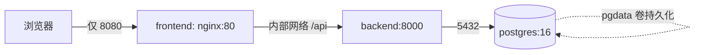

# 生产服务器离线部署指南（Ubuntu + 离线镜像）

> 适用范围：目标服务器为 Ubuntu 22.04 / 24.04（其他 Debian 系类同），**无需联网 build**、不依赖镜像仓库。
> 本文聚焦「系统层安装 + 离线镜像实例化」。CA 下载导入、启用 HTTPS、端口冲突与反向代理见《服务部署与运维操作指导》第 11–13 节。
> 前置交付物（由源/测试服务器 `scripts/export-images.sh` 产出或手工准备）：
> - `domaintoolbs-images-1.0.tar.gz`（含 backend/frontend/postgres 三个镜像）
> - `docker-compose.prod.yml`
> - `.env.prod.example`

---

## 0. 架构与端口（心里有数）

- 对外**只开放 8080**（前端 nginx）。
- backend `8000` / postgres `5432` **不对外**，仅容器间通信。
- 数据库数据在 `pgdata` 命名卷，容器删了数据也在（空系统重建：无需导入历史数据，超管经服务器侧创建）。



---

## 1. 安装 Docker 与 compose 插件

### 1.1 生产机能联网（推荐首次安装）

```bash
sudo apt update
sudo apt install -y ca-certificates curl gnupg lsb-release
sudo install -m 0755 -d /etc/apt/keyrings
sudo curl -fsSL https://download.docker.com/linux/ubuntu/gpg -o /etc/apt/keyrings/docker.asc
sudo chmod a+r /etc/apt/keyrings/docker.asc
echo "deb [arch=$(dpkg --print-architecture) signed-by=/etc/apt/keyrings/docker.asc] https://download.docker.com/linux/ubuntu $(. /etc/os-release && echo "$VERSION_CODENAME") stable" \
  | sudo tee /etc/apt/sources.list.d/docker.list > /dev/null
sudo apt update
sudo apt install -y docker-ce docker-ce-cli containerd.io docker-compose-plugin
sudo systemctl enable --now docker
# 让当前用户免 sudo 跑 docker（执行后重登一次生效）
sudo usermod -aG docker $USER
```

### 1.2 完全离线（生产机无外网，Docker 也离线装）

需要一台**同版本、能联网的 Ubuntu** 作「下载端」，先把 deb 包抓全，再拷到生产机安装。装好后防火墙、开机自启、加载镜像等步骤与 1.3 / 第 2–6 节完全一致。

**① 下载端：加 Docker 官方源并递归抓取全部 deb**

```bash
# 若下载端还没加 Docker 源（否则只能下到 Ubuntu 仓库的 docker.io，而非 docker-ce）
sudo apt update
sudo apt install -y ca-certificates curl gnupg lsb-release
sudo install -m 0755 -d /etc/apt/keyrings
sudo curl -fsSL https://download.docker.com/linux/ubuntu/gpg -o /etc/apt/keyrings/docker.asc
sudo chmod a+r /etc/apt/keyrings/docker.asc
echo "deb [arch=$(dpkg --print-architecture) signed-by=/etc/apt/keyrings/docker.asc] https://download.docker.com/linux/ubuntu $(. /etc/os-release && echo "$VERSION_CODENAME") stable" | sudo tee /etc/apt/sources.list.d/docker.list > /dev/null
sudo apt update

# 递归下载 docker-ce / cli / containerd / compose 插件及依赖到目录
mkdir -p ~/docker-offline && cd ~/docker-offline
apt-get download \
  $(apt-cache depends --recurse --no-recommends --no-suggests \
    --no-conflicts --no-breaks --no-replaces --no-enhances \
    docker-ce docker-ce-cli containerd.io docker-compose-plugin \
    | grep "^\w" | sort -u) 2>/dev/null
ls -lh ~/docker-offline        # 至少应含 docker-ce_*.deb / docker-ce-cli_*.deb / containerd.io_*.deb / docker-compose-plugin_*.deb
```

**② 把 deb 包整体带到生产机**（U 盘，或经能联网的中转机 scp）

```bash
# 在下载端打成 tar
cd ~ && tar czf docker-offline.tar.gz -C ~ docker-offline
# 拷到生产机 /tmp（示例经中转机）
scp docker-offline.tar.gz ubuntu@<生产机IP>:/tmp/
```

**③ 生产机：离线安装**

```bash
sudo mkdir -p /opt/docker-offline
sudo tar xzf /tmp/docker-offline.tar.gz -C /opt/docker-offline --strip-components=1
cd /opt/docker-offline
sudo dpkg -i *.deb

# 若 dpkg 报依赖缺失：离线环境 apt 无法联网补全，需回到下载端把缺失的 *.deb 一并带来后重跑 dpkg -i
sudo systemctl enable --now docker
sudo usermod -aG docker $USER     # 重登后生效
docker --version
docker compose version            # 确认 V2（空格）
```

> 离线安装本身不联网；但 `dpkg -i` 前请确认下载端与生产机 Ubuntu 版本/架构一致，否则依赖可能不匹配。其余步骤（防火墙、自启、load/up、建超管、验证）照常。

### 1.3 验证

```bash
docker --version
docker compose version          # 注意 V2 是空格，不是连字符
systemctl is-enabled docker     # 应返回 enabled
```

---

## 2. 防火墙（仅开 8080，保留 SSH）

```bash
sudo ufw allow OpenSSH          # 先放行 SSH，避免把自己锁外面
sudo ufw allow 8080/tcp         # 仅开放前端
sudo ufw enable
sudo ufw status                 # 确认 22/tcp(OpenSSH) 与 8080/tcp 为 ALLOW
```

> 8000 / 5432 不要对公网开放；如需远程调试 backend，请走 SSH 端口转发，而非直接对外。

---

## 3. 开机自启

- **Docker 守护进程**：步骤 1 已 `systemctl enable --now docker`，服务器重启后守护进程自动起。
- **业务容器**：`docker-compose.prod.yml` 中 db/backend/frontend 均已配置 `restart: unless-stopped`，守护进程起来后会自动拉起容器。
- 校验：`systemctl is-enabled docker` 为 `enabled` 即可，无需额外配置。

---

## 4. 加载镜像并启动

```bash
# 1) 建部署目录，把三个交付物放进来
sudo mkdir -p /opt/DomainToolBS-deploy && cd /opt/DomainToolBS-deploy
#    （用 scp 把 tar / docker-compose.prod.yml / .env.prod.example 传到此目录）

# 2) 加载离线镜像
docker load < domaintoolbs-images-1.0.tar.gz
docker images     # 确认 domaintoolbs-backend:1.0 / domaintoolbs-frontend:1.0 / postgres:16 都在

# 3) 生成生产配置（密钥必须稳定，切勿留空/随机）
cp .env.prod.example .env
#    编辑 .env，填入：
#      DB_PASSWORD=<强密码>
#      JWT_SECRET_KEY=<openssl rand -hex 32 的输出>
#      FERNET_KEY=<python3 -c "from cryptography.fernet import Fernet; print(Fernet.generate_key().decode())" 的输出>
#      CORS_ORIGINS=http://<生产机IP>:8080

# 4) 启动（一键脚本，或手敲下面那条命令）
bash scripts/import-images.sh
#    等效手敲：
#    docker compose -f docker-compose.prod.yml --env-file .env up -d
```

> backend 启动时 `main.py` 的 startup 事件会自动 `init_db()` 建表，无需手动初始化。

---

## 5. 创建超级管理员（服务器侧唯一途径）

```bash
docker compose -f docker-compose.prod.yml exec backend \
  python scripts/reset_superadmin.py --username admin --password 'StrongP@ssw0rd!'
```

- 脚本随镜像分发（见 `backend/Dockerfile` 的 `COPY scripts ./scripts`），容器内路径为 `/app/scripts/reset_superadmin.py`。
- 仅服务器侧可执行，满足「超管密码忘记只能服务端找回」的安全约定。

---

## 6. 验证

```bash
docker compose -f docker-compose.prod.yml ps        # 三个服务 healthy/up
curl -s http://localhost:8000/health                # {"status":"ok",...}
curl -s http://localhost:8080/ | grep -o '<title>.*</title>'
```

浏览器打开 `http://<生产机IP>:8080`，用 `admin` / 刚设的密码登录。

---

## 7. 硬约束（务必守住）

1. **`FERNET_KEY` / `JWT_SECRET_KEY` 必须固定写入 `.env`**：空系统虽无历史密文，但若留空，容器重启可能随机生成，导致后续加密的域账号密码跨实例不一致、JWT 令牌失效。
2. **`CORS_ORIGINS` 改生产前端真实地址**（模板里是占位 `your-server-ip`）。
3. **数据库数据在 `pgdata` 卷，不在镜像中**：符合空系统重建预期；升级/重启不丢数据。
4. **密钥/密码不进镜像**：只经 `.env` 运行时注入；`.env` 已被 `.gitignore` 忽略，切勿提交真实值。
5. **生产编排用 `docker-compose.prod.yml`**（去 build、固定镜像名），不要让生产机执行 `docker compose build`。

---

## 8. 升级 / 重新部署

- 源机代码更新后重跑 `scripts/export-images.sh` 生成新 tar。
- 生产机：`docker load < 新tar` → `docker compose -f docker-compose.prod.yml --env-file .env up -d`（容器按 `restart` 策略滚动重建，数据卷不变）。
- 仅当 `docker-compose.prod.yml` 结构变化时才需同步该文件；`.env` 密钥保持不变。
